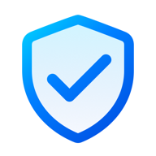
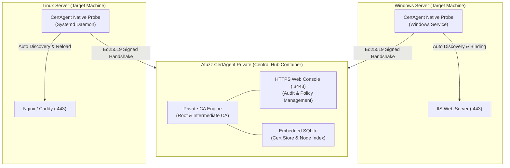

<div align="center">



# Atuzz CertAgent Private

**Air-Gapped Private CA & Automated SSL Mount Hub for Intranet Infrastructure**  
*Enterprise-grade, zero-config internal HTTPS green locks for any private network.*

[](LICENSE)
[](https://github.com/BaguetteLee/atuzz-certagent-private/pkgs/container/atuzz-certagent-private)
[](https://certagent.net)
[](#-free-community-edition)
[](#-quick-start-in-2-commands)

**[ 🇨🇳 简体中文文档请点击这里 (Chinese Documentation) ](README_zh.md)**

[Architecture](#-architecture) · [Cloud SaaS](#-managing-public-domain-ssl-certificates) · [Features](#-key-features) · [Quick Start](#-quick-start-in-2-commands) · [Comparison](#-the-problem-we-solve) · [Client Trust](#-one-click-client-trust) · [Licensing](#-licensing--enterprise-support)

</div>

---

## 🏛️ Architecture



> [!TIP]
> ### 🌐 Managing Public Domain SSL Certificates?
> If you are looking to automate public TLS certificates (issued by globally trusted CAs like **Let's Encrypt** or **ZeroSSL**) across AWS, Aliyun, Tencent Cloud, Cloudflare, Nginx, or IIS without hosting your own Docker infrastructure:
> 
> 👉 **Use our official fully-managed platform: [CertAgent Cloud (https://certagent.net)](https://certagent.net)**  
> *100% Free automated public domain certificate issuance, smart DNS validation, and silent multi-server mounting.*

---

## 💡 The Problem We Solve

In private networks, internal company intranets, Homelabs, and air-gapped data centers:

| Challenge | Traditional Approach | Atuzz CertAgent Private Solution |
| :--- | :--- | :--- |
| **Private IP & Internal Hostnames** | Public CAs (Let's Encrypt / ZeroSSL) **refuse** to issue certs for `192.168.x.x` or `.local` | **Native Support**: Full green-lock support for RFC 1918 IPs, IPv6, and internal hostnames |
| **Certificate Lifecycle Management** | Tedious OpenSSL configs, manual CSRs, and error-prone SAN inputs | **Zero-Touch Automation**: 100% automated issuance, deployment, and atomic renewal |
| **Web Server Binding (IIS / Nginx)** | Manual certificate export, PFX password handling, and manual port binding | **Silent Mounting**: Probes detect websites and configure HTTPS bindings automatically |
| **Expired Certificate Outages** | Unexpected expiration leading to API breaks and red security warnings | **Atomic Pre-Renewal**: Auto-rotates 30 days prior to expiration with zero downtime |
| **Air-Gapped & Compliance** | External dependencies fail in offline or classified environments | **100% Offline Ready**: Embedded CA engine with zero outbound internet requests |

---

## ✨ Key Features

- **100% Air-Gapped Ready**: Zero outbound internet requests. Operates entirely self-contained within physical disconnected environments.
- **Private IP & Internal Hostname Green Locks**: Native support for RFC 1918 private IPv4 (`10.0.0.0/8`, `172.16.0.0/12`, `192.168.0.0/16`), IPv6, single-label names, and internal domains (`.local`, `.internal`).
- **Zero-Config IIS & Nginx Mounting**: Cross-platform native probes silently detect web sites and mount SSL bindings automatically.
- **Atomic Renewal & Cascading CRL**: Auto-renews 30 days before expiration, archives previous snapshots for auditing, and issues RFC 5280 cascading CRLs.
- **Single Lightweight Container**: ~100MB Docker image with embedded SQLite, web UI, and built-in agent probe downloads.
- **Cryptographic Security**: Ed25519 asymmetric signatures, HMAC-SHA256 dynamic handshakes, and atomic Nonce anti-replay protection.

---

## 🚀 Quick Start in 2 Commands

Deploy anywhere Docker is installed:

### 1. Download and start with Docker Compose

```bash
# Download official docker-compose.yml
curl -fsSL https://raw.githubusercontent.com/BaguetteLee/atuzz-certagent-private/main/docker-compose.yml -o docker-compose.yml

# Start the hub
docker compose up -d
```

> **Tip**: *(Optional)* Run `curl -fsSL https://raw.githubusercontent.com/BaguetteLee/atuzz-certagent-private/main/.env.example -o .env` to customize default ports (`3000` / `3443`) and storage paths before launching.

### 2. Open the Web Console
Visit in your browser:
- **Management Console**: `https://<YOUR-SERVER-IP>:3443`
- **First-time Setup Wizard**: No default factory passwords. You will be prompted to set your administrator password securely upon first visit.

> **Port Guide**:
> - `3443 (HTTPS)`: Native green-lock management console and admin API;
> - `3000 (HTTP)`: Public bootstrap endpoint (provides Root CA downloads, installation scripts, and probe registration).

---

## 💻 One-Click Client Trust

Eliminate browser red security warnings across your network with built-in trust scripts:

### Windows (Chrome / Edge / IIS Hosts)
Run in Administrator Command Prompt:
```cmd
curl -fsSL "http://<YOUR-HUB-IP>:3000/api/ca/install-script?os=windows" -o install-root-ca.bat
install-root-ca.bat
```

### Linux (Ubuntu / Debian / CentOS / Rocky / Alpine)
Import into system trust store with a single line:
```bash
curl -fsSL "http://<YOUR-HUB-IP>:3000/api/ca/install-script?os=linux" | sudo bash -s "http://<YOUR-HUB-IP>:3000"
```

---

## 🎁 Free Community Edition

We believe in making private network security accessible to everyone:

- **Free for up to 3 probe server nodes concurrently**;
- **Unlimited domains, unlimited certificates, and unlimited websites per node**;
- Permanent free use for personal projects, testing, and small business production.

---

## 🏢 Licensing & Enterprise Support

For large-scale production deployments managing more than 3 server nodes:

- **Enterprise Benefits**:
  - 🔓 Unlimited node capacity;
  - 🔑 Machine-bound offline licenses or enterprise-wide site buyout keys;
  - 🛠️ Direct technical support and custom intranet topology assistance.
- **Contact Us**:
  - Inquiries & Support: **`support@certagent.net`**
  - Bug Reports & Discussions: [GitHub Issues & Discussions](https://github.com/BaguetteLee/atuzz-certagent-private/issues)

---

## 📜 License

This project is distributed under the **Atuzz Community & Commercial License 1.0 (ACCL-1.0)**:
- Free for personal use, testing, and production deployments of up to 3 nodes;
- Commercial license required for managing more than 3 production nodes;
- Reverse engineering, decompilation, and unauthorized rebranding ("white-labeling") are strictly prohibited;
- See the [LICENSE](LICENSE) file for complete details.

<div align="center">
<sub>Powered by Atuzz · © 2026 Atuzz. All rights reserved.</sub>
</div>
