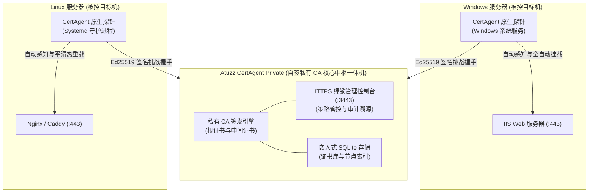

<div align="center">


# Atuzz CertAgent Private

**企业级离线私有 CA 与内网 SSL 证书全自动挂载一体机**  
*面向私企团队、独立极客与各类内网私有部署的零配置 HTTPS 绿锁解决方案*

[](LICENSE)
[](https://github.com/BaguetteLee/atuzz-certagent-private/pkgs/container/atuzz-certagent-private)
[](https://certagent.net)
[](#-社区版免费配额)
[](#-两行命令极速启动)

**[ 🌐 English Version Click Here (View English README) ](README.md)**

[系统架构](#-系统架构-architecture) · [公网云托管](#-需要管理公网域名证书不想自己维护-docker-容器) · [核心特性](#-核心产品特性) · [极速启动](#-两行命令极速启动) · [痛点对比](#-为什么需要-atuzz-certagent-private) · [客户端信任](#-客户端一键信任根证书) · [商业支持](#-商业授权与支持-enterprise--support)

</div>

---

## 🏛️ 系统架构 (Architecture)



> [!TIP]
> ### 🌐 需要管理公网域名证书？不想自己维护 Docker 容器？
> 如果您的实际需求是为标准公网域名（由 **Let's Encrypt** 或 **ZeroSSL** 国际权威机构签发）实现全自动申请、智能 DNS 验证、多服务器静默部署与到期自动续签：
> 
> 👉 **推荐直接使用我们的官方全托管云平台：[Atuzz CertAgent Cloud 证书运维云 (https://certagent.net)](https://certagent.net)**  
> *开箱即用，无需自己运维服务器，永久免费提供公网域名证书自动化生命周期管理与多节点静默挂载服务！*

---

## 💡 为什么需要 Atuzz CertAgent Private？

在企业内网、团队局域网、个人 Homelab 及私有物理机房环境中：

| 局域网运维挑战 | 传统手动处理方式 | Atuzz CertAgent Private 解决方案 |
| :--- | :--- | :--- |
| **私有 IP 与内网私有域名** | 公网免费 CA（Let's Encrypt / ZeroSSL）**严拒**向 `192.168.x.x` 或 `.local` 签发证书 | **原生全量支持**：全面支持 RFC 1918 私网 IP、IPv6、单主机名与私有后缀 |
| **证书生命周期运维** | 晦涩的 OpenSSL 命令行、反复手工生成 CSR、极易填错的 SAN 扩展项 | **零心智负担**：全流程自动化签发、静默部署与原子轮换 |
| **Web 容器证书绑定 (IIS/Nginx)** | 手动导出证书、配置 PFX 密码、在 IIS 或 Nginx 手动重新绑定端口 | **无感全自动挂载**：探针静默发现本地站点并全自动绑定 HTTPS |
| **证书过期引发业务宕机** | 人工维护极易疏漏，到期引发全网大面积红标拦截甚至 API 熔断 | **到期前无感原子轮换**：到期前 30 天自动无感更新，平滑热重载 |
| **纯内网断网与等保密评** | 依赖外部公网 CA 回调的方案在纯内网机房完全瘫痪 | **100% 物理脱机就绪**：纯离线单容器一体机，零外网网络请求 |

---

## ✨ 核心产品特性

- **100% 纯物理离线就绪 (Air-Gapped Ready)**：代码中零外部网络依赖，彻底脱离公网环境，内网安全无阻。
- **内网 IP 绿锁原生支持**：支持 RFC 1918 私网 IPv4（`10.0.0.0/8`, `172.16.0.0/12`, `192.168.0.0/16`）、IPv6、单机主机名（如 `oa`, `erp`）与私有后缀（`.local`, `.internal`）。
- **Windows IIS / Linux Nginx 零配置自动化挂载**：被控主机仅需运行一个数十兆的原生独立探针，即可静默感知本地站点并全自动绑定 SSL，无需手动修改 Web 配置文件。
- **原子轮换续签与等保 CRL 级联吊销**：到期前 30 天自动触发无感轮换与旧证书快照历史归档，提供 RFC 5280 标准级联 CRL 吊销黑名单，满足密评审计溯源。
- **轻量单容器秒级交付**：体积仅 ~100MB，内置自签 CA 引擎、Web 管理控制台与跨平台探针二进制分发，无需繁复的外部数据库依赖（内置自愈 SQLite）。
- **密码学级通信安全**：探针与中枢基于 Ed25519 非对称签名、HMAC-SHA256 动态握手与 Nonce 原子抗重放，杜绝内网伪造与中间人攻击。

---

## 🚀 两行命令极速启动

只要安装了 Docker，两行指令即可开箱即用：

### 1. 下载编排配置并拉起容器

```bash
# 下载官方开箱即用 docker-compose.yml
curl -fsSL https://raw.githubusercontent.com/BaguetteLee/atuzz-certagent-private/main/docker-compose.yml -o docker-compose.yml

# 启动服务
docker compose up -d
```

> **提示**：*(可选)* 若需自定义端口（默认 `3000` / `3443`）或存储路径，可在启动前下载环境变量模板并重命名为 `.env`：  
> `curl -fsSL https://raw.githubusercontent.com/BaguetteLee/atuzz-certagent-private/main/.env.example -o .env`

### 2. 进入管理控制台
打开浏览器访问：
- **管理控制台**：`https://<你的服务器IP>:3443`
- **首次访问引导 (Setup Wizard)**：系统无任何出厂默认弱口令，首次访问页面时由您亲自设定管理员登录密码。

> **端口说明**：
> - `3443 (HTTPS)`：原生私有自签绿锁 Web 控制台与管理端；
> - `3000 (HTTP)`：公共服务端口（提供客户端 Root CA 根证书下载、一键安装脚本拉取与探针注册）。

---

## 💻 客户端一键信任根证书

为了让内网客户端（电脑浏览器、手机、API 调用端）全链路信任私有 CA 并彻底消除浏览器红标拦截，控制台内置了一键信任脚本：

### Windows 客户端 (Chrome / Edge / IIS 宿主机)
以管理员身份运行一键批处理（或直接在控制台【信任中心】一键下载）：
```cmd
curl -fsSL "http://<你的中枢IP>:3000/api/ca/install-script?os=windows" -o install-root-ca.bat
install-root-ca.bat
```

### Linux 客户端 (Ubuntu / Debian / CentOS / Rocky / Alpine)
单行命令静默导入系统受信任根证书库：
```bash
curl -fsSL "http://<你的中枢IP>:3000/api/ca/install-script?os=linux" | sudo bash -s "http://<你的中枢IP>:3000"
```

---

## 🎁 社区版免费配额

Atuzz 坚持 **“开放免费使用，赋能个人与中小企业”**：

- **单实例默认免费放行 3 台被控服务器**；
- **单服务器节点完全不限制网站数量、不限制域名/IP 数量、不限制证书签发总量**；
- 永久免费使用，包含私有根 CA、自动轮换、控制台管理与 CRL 吊销全套功能。

---

## 🏢 商业授权与支持 (Enterprise & Support)

面向纳管超过 3 台服务器节点的企业级生产集群、复杂跨机房或有定制化支持需求的企业：

- **商业特权**：
  - 🔓 永久解除节点配额限制（支持扩展至数十、数百台乃至无限制服务器节点）；
  - 🔑 支持指定机器码物理绑定或企业专属通配买断授权；
  - 🛠️ 专属一对一技术支持与复杂私网拓扑无感挂载定制。
- **获取商业授权**：
  - 商务与授权咨询：**`support@certagent.net`**
  - 技术提问与社区反馈：[GitHub Issues & Discussions](https://github.com/BaguetteLee/atuzz-certagent-private/issues)

---

## 📜 许可协议 (License)

本项目采用 **Atuzz 社区与商业终身许可协议 (ACCL-1.0)** 分发：
- 个人使用、非生产环境评估测试完全免费；
- 生产环境单实例纳管 3 个节点以内**永久免费**；
- 生产环境纳管 3 个以上节点需获得官方商业授权；
- 严禁未经授权的反编译、逆向工程、破解或二次贴牌转卖。
- 详情请查阅 [LICENSE](LICENSE) 文件。

<div align="center">
<sub>Powered by Atuzz · © 2026 Atuzz. All rights reserved.</sub>
</div>
